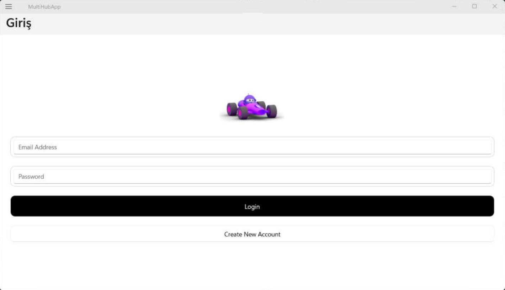

# MultiHub — All-in-One Daily Dashboard App

A cross-platform mobile app built with **.NET MAUI** that brings live exchange rates, news, weather and a personal task list together behind one login.


## Screenshots



## Features

| Module | What it does | Data source |
|---|---|---|
| 🔐 **Authentication** | Sign up, sign in and token refresh | Firebase Auth REST API |
| 💱 **Exchange rates** (Kurlar) | Live exchange rates with color-coded daily change | Truncgil Finance API |
| 📰 **News** (Haberler) | Headlines by category, with a detail page | TRT Haber RSS |
| 🌤️ **Weather** (Hava Durumu) | Current conditions and 5-day forecast by city | Turkish State Meteorological Service (MGM) |
| ✅ **Tasks** (Yapılacaklar) | Add, edit and complete tasks | Firebase Realtime Database + local JSON |
| ⚙️ **Settings** (Ayarlar) | Profile and theme | Local storage |

## Architecture

- **MVVM**: view models (`TasksViewModel`, `HaberlerViewModel`, `EditTaskViewModel`) on a shared `BaseViewModel`
- **Services**: `AuthService`, `CurrencyService`, `HavaDurumuServisi`, `TaskService`, `LocalProfileService`
- **Shell navigation** with a flyout menu
- **Value converters** for data-driven colors and formatting
- `TurkishNormalizer` to map city names with Turkish characters to API queries

## Run

Requirements: .NET 10 SDK with the MAUI workload (included in Visual Studio's ".NET Multi-platform App UI development" workload).

```bash
dotnet workload install maui
dotnet build -t:Run -f net10.0-windows10.0.19041.0   # Windows
dotnet build -t:Run -f net10.0-android               # Android
```

On Windows, turn on Developer Mode (Settings → System → For developers) to run the app from Visual Studio.

---

Made by [Mariam Mahmoud](https://github.com/mar7233)
